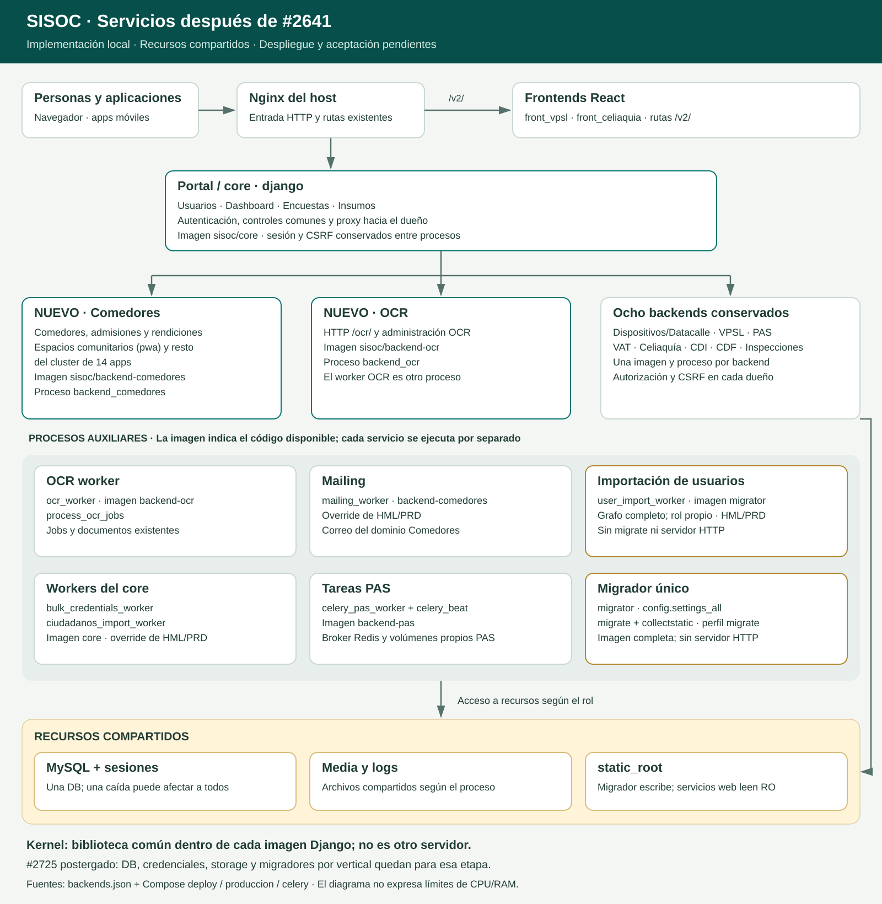
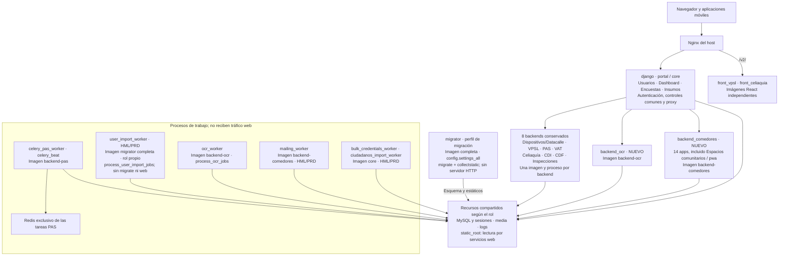

# Servicios de SISOC después de #2641

Estado: implementación y ensayos locales. Este documento describe el resultado
del PR; no afirma que esa versión esté desplegada. Relacionado con #2641.

## Qué cambia para quien mantiene el sistema

El portal deja de cargar Comedores y OCR. Conserva Usuarios, Dashboard, Encuestas
e Insumos y sigue siendo la entrada Django: autentica, aplica los controles
comunes y reenvía al backend dueño. Los diez backends tienen proceso e imagen
propios. El kernel es código común empaquetado en cada imagen Django, no un
servidor adicional. Las rutas públicas se conservan.

Por ejemplo, `/comedores/listar` entra por el portal y se atiende en
`backend_comedores`; `/ocr/`, en `backend_ocr`. El backend vuelve a comprobar
sesión, permisos y CSRF. Si Comedores falla, su listado responde 503 mientras
las operaciones independientes del portal y otros backends pueden continuar.

## Diagrama fuente para GitHub

Las flechas muestran tráfico o acceso a recursos. Los workers indican su imagen
dentro del nodo; compartir imagen no significa compartir proceso. La cantidad
de réplicas depende del Compose y la configuración de cada entorno.

## Cómo leer las responsabilidades

| Proceso o recurso | Responsabilidad y límite |
| --- | --- |
| Portal `django` | Entrada y proxy existentes; identidad y controles comunes. Sigue siendo un punto común del tráfico Django |
| Comedores | Catorce apps cohesivas: Comedores, Admisiones, Duplas, Relevamientos, rendiciones, organizaciones operativas, Espacios comunitarios y las demás apps del cluster. Detalle exacto en `src/backends/config/backends.json` |
| OCR web y worker | Procesos diferentes con la misma imagen OCR. El worker procesa jobs existentes y conserva almacenamiento y autorizaciones |
| Ocho backends previos | Se conservan sus dueños, imágenes, rutas y runtimes. El proxy no requiere instalar su código en el portal |
| Importador de usuarios | Reutiliza la imagen completa del migrador, por decisión aprobada. Su rol evita ejecutar migraciones o Gunicorn. Al cambiar cualquier backend hay que actualizar también este worker donde exista |
| Migrador | Único responsable del grafo completo y de `collectstatic`. Los servicios web y el importador no migran al arrancar |
| Datos y sesión | Una MySQL compartida; sesiones y clave de firma compatibles entre procesos. Una caída de DB puede afectar a todos |
| Archivos | Media y logs compartidos según los mounts del rol; estáticos recolectados por migrador y leídos por las webs. Redis y los volúmenes de PAS conservan sus funciones actuales |
| Kernel | Identidad, auditoría común, ciudadanos y otros maestros compartidos como biblioteca dentro de las imágenes Django |

## Ruta sugerida para revisar el PR

1. Leer este diagrama y el alcance del PR. Comparar la entrada única con los
   procesos separados y los recursos que siguen compartidos.
2. Revisar los commits de identidad/C0–C1 y consumidores/C2: operaciones
   independientes, operaciones compuestas, Ciudadano 360, favoritos y Montos.
3. Revisar Comedores/C3 y OCR/C4 con detección de renombres. Gran parte del
   volumen corresponde a mover código, templates, estáticos, fixtures y tests.
4. Leer las decisiones del importador y la auditoría antes de evaluar la reversa.
5. Leer fixtures, dependencias y los registros de ensayos; distinguir pruebas
   focalizadas, HTTP local, CI remota y aceptación humana.

## Incorporación, reversa y pendientes

La primera incorporación requiere reconstrucción completa y migrador porque
este PR también cambia configuración compartida, dependencias y Dockerfile.
Después, el selector permite seleccionar dueños y sus workers asociados.
La prueba local de caída/recuperación no acredita uptime de entornos existentes.

La migración C1 conserva la tabla física y los identificadores de auditoría,
pero traslada estado y metadata de `pwa` a `audittrail`. La reversa requiere
coordinar esa metadata y las imágenes; volver a una imagen anterior por sí
solo no deshace el cambio. Preservar lotes y archivos de jobs pendientes.

Quedan suite integral/CI, aceptación humana y pruebas operativas autorizadas
de salud de workers, deploy selectivo y rollback. #2725 continúa postergado:
DB, credenciales, storage y migradores por vertical pertenecen a esa etapa.
Insumos y Encuestas permanecen en el portal.

## Fuentes de verdad y evidencia

- Registro: `src/backends/config/backends.json`.
- Procesos: `docker/compose/docker-compose.deploy.yml`,
  `docker/compose/docker-compose.produccion.yml` y
  `docker/compose/docker-compose.celery.yml`.
- [Guía de verticales](verticales_independientes.md).
- [Decisión del importador](../registro/decisiones/2026-10-16-c3-worker-importacion-imagen-migrador.md).
- [Decisión OCR](../registro/decisiones/2026-10-16-c4-ocr-runtime.md).
- [Builds y aislamiento](../registro/cambios/2026-T4/2026-10-16-issue-2641-build-limpio-docker.md).
- [Smoke HTTP y estáticos](../registro/cambios/2026-T4/2026-10-19-issue-2641-smoke-http-docker.md).
