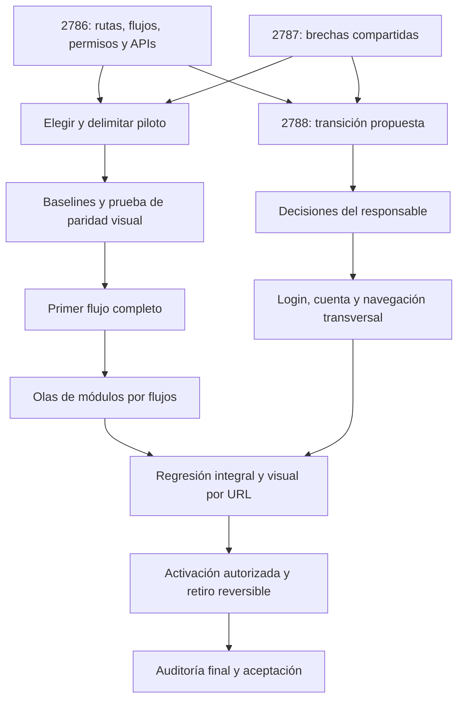

# Plan aprobado: migración integral a React con paridad visual (#2785)

## Estado, objetivo y autoridad

**Alcance vigente: E2, planificación integral exclusivamente.** El responsable
aclaró que la implementación debe salir de este plan y que ahora corresponde
profundizarlo. No se inicia código, checkout de implementación, entorno ni DB.
G1, PAS P1 y Ciudadano 360 C2 permanecen elegidas; E2 no las revoca.

Conteo documental vigente: **215 propuestas en 95 familias** tras añadir U02.03
(cambio voluntario estándar). Los conteos de 214 en secciones anteriores describen
la descomposición inicial; ninguno equivale a tickets listos o implementación.

Fecha: 2026-10-27. Base inspeccionada: `origin/development`, SHA
`afa6fcf4bb221082d5fa692ff941be75bc74d8d1`. Rama documental:
`docs/2785-plan-migracion-react` (inicial). El responsable respondió «apruebo» después de
recibir las alternativas, la recomendación A y el piloto de Insumos. Se registra
la aprobación del plan y sus recomendaciones de transición. La autoría del
análisis de alternativas sigue siendo del agente. No se infiere autorización
para activar servicios, cambiar producción ni ejecutar migraciones.

La elección de detalle de contratos, campos, nombres y mapeos exactos sigue
pendiente cuando la propuesta la dejó abierta. La aprobación no demuestra
comprensión técnica ni aceptación funcional/visual: no se hizo teach-back ni
se ejecutaron recorridos. Antes de implementar una decisión material se cerrará
su contrato y el control de comprensión previsto en AGENTS.md. No se crea un
tracker adicional para esa comprensión pendiente.

Durante la preparación avanzó `origin/development` a
`2d7a13d71cea455b6480e5ad32cb6311e680d397` por merge de #2784. El diff desde
la base inspeccionada comprende dependencias Python, generación de PDF de
relevamientos, su test y documentación del PR; no cambia las declaraciones de
rutas ni el conjunto HTML extraído. Se conserva el SHA del relevamiento para
trazabilidad. Antes de implementar se actualizará la base y se revisarán las
versiones y la integración documental; esta rama no se rebaseó ni mergeó.

Pedido confirmado por el responsable en esta conversación:

> El diseño debe quedar idéntico al actual. Al final debemos hacer un diff
> visual de cada URL tocada y verificar que se vea bien.

React reemplaza toda presentación e interacción del alcance, incluidos todos los formularios. No se cierra la migración dejando formularios Django. M2 activa circuitos completos React; el backend puede reutilizar validadores/Form existentes sin renderizar UI Django. Django conserva dominio, validación,
autorización, transacciones, archivos, tareas e integraciones. Se preservan
comportamiento y apariencia: distribución, tipografía, colores, iconos, tamaños,
espaciado, densidad, tablas, controles, navegación, textos y estados responsive.
No se interpreta la migración como permiso para rediseñar.

## Decisiones vigentes y definiciones futuras

| Punto | Estado real | Consecuencia para la planificación |
|---|---|---|
| Estrategia incremental y piloto Insumos | Orientación aprobada | Organizar por recorridos, conservar Django de dominio y medir patrón antes de escalar |
| Apariencia idéntica y diff por URL | Confirmado | Cero diferencias inesperadas; incluir aliases, estados y consumidores indirectos |
| G1 entre servicios | Alternativa elegida | Cerrar representación/clave/rotación/reloj y probar recepción antes de nuevas APIs web remotas; no exige implementarla ahora |
| PAS P1 | Elegida | Preservar interferencia de sesión restringida en entry/datos/POST; invitado anónimo sigue por token |
| Ciudadano 360 C2 | Elegida | Única excepción aquí aprobada: `No disponible` ante aporte fallido en 360; no extender a dashboards |
| E2 | Elegida y aclarada | Planificar toda la migración; no volver a proponer ejecución del piloto como paso automático |
| Contexto, app sisoc y namespace web propuestos | Contratos para revisar, sin código | Definirlos con el flujo; G1 no aprueba por omisión nombres, campos, errores o rutas |
| Referencia visual por flujo | Pendiente de fijación/aceptación en fase futura | Un SHA de inventario o un merge no constituye baseline aceptado; no rebaselinar para esconder cambios |
| Referencia INET I1 | Elegida explícitamente | Django como referencia; reutilizar API/services integrados y adaptar presentación solo según comparación; no inferir paridad del merge |
| Lista de espera CDF W1 | Elegida explícitamente | Usar sección de ficha de actividad y conservar URL antigua como acceso compatible; no crear pantalla independiente |
| Avisos/circuito M2 | Elegida tras aclarar que todos los formularios deben ser React | Activar lectura y operaciones de retorno como circuito completo React, con feedback propio; sin puente M1 ni formularios Django residuales al cierre |
| Activación, retiro y entorno | Fuera de autorización E2 | Preparar compatibilidad/retorno y pruebas, sin ejecutar ni crear servicios |

La continuación posterior encontró I1/I2 y el responsable eligió I1, registrada
en el contraste de reutilización. El cruce de contratos/templates encontró después
W1/W2 de lista de espera CDF y el responsable eligió W1. Las demás dudas investigables se
resuelven en el contrato del slice. Las que requieren ejecución —por ejemplo
tiempos de cola o representación WSGI real— llevan experimento pendiente y no
se presentan como verificadas. Si la investigación cambia alcance, seguridad,
experiencia o costo, se preparan alternativas concretas antes de pedir decisión.

El responsable confirmó que admin/Unfold #2789 queda aparte: la excepción sigue vigente y ese trabajo paralelo no se toca. Se reutilizan los demás criterios y excepciones confirmados en
[#2785](https://github.com/secretarianaf/SISOC/issues/2785): admin, generación de
PDF y correos permanecen en Django; las pantallas que los gestionan sí entran.
Celiaquía y VPSL son antecedentes, con regresión obligatoria si cambia código
común. PWA externas, tablas/modelos, aislamiento de datos y proxy quedan fuera.

La ventana del 26–30 de octubre figura en la épica; no existe una estimación
validada de capacidad. Este plan no promete migrar todo dentro de esa ventana.

## Entregables y límites de la evidencia actual

Continuación vigente: W1 fue elegida y se derivó la tarea futura
[#2811](https://github.com/secretarianaf/SISOC/issues/2811). Las
[fichas prioritarias](2026-10-27-2785-fichas-prioritarias.md) concretan resultado,
contrato, negativos y dependencias de las primeras entregas. Al revisar retornos
se encontró [M1/M2 de avisos y unidad de activación](2026-10-27-2788-avisos-y-unidad-activacion.md),
resuelta con M2: formularios y feedback React antes de activar el circuito público. Ningún avance documental autoriza implementación bajo E2.

Para preparar la implementación futura, leer después de este plan:

1. [Catálogo integral: 95 familias y 214 entregas propuestas](2026-10-27-2785-entregas-por-flujo.md), con [datos estructurados](2026-10-27-2785-entregas-por-flujo.json) y fuentes por familia.
2. [Secuencia y dependencias](2026-10-27-2785-secuencia-por-flujos.md): qué bloquea una entrega, qué puede convivir y dónde reutilizar INET.
3. [Aceptación, riesgos y retiro](2026-10-27-2785-aceptacion-riesgos-y-retiro.md): cobertura por URL, diff acumulado, 18 riesgos y barreras de salida.
4. Contratos específicos #2798 y #2805–#2808 y manifiestos vinculados desde este plan; el paquete Insumos es solo un caso de la migración completa.

Profundización posterior de los cinco puntos: [contratos compartidos y remediaciones](2026-10-27-2798-contratos-y-remediaciones.md)
precisa campos, permisos/visibilidad y efectos de identidad. El
[contraste INET por recurso/acción](2026-10-27-2794-reutilizacion-y-referencia-visual.md)
expande 63 rutas API y encuentra una decisión de referencia I1/I2: Django de
centros fuerza oscuro; INET React ofrece modos y arranca claro salvo preferencia.
No se asume otra excepción visual por haber sido integrado el PR.

I1 fue elegida después; [registro de referencia INET](../../registro/decisiones/2026-10-27-2794-inet-referencia-i1.md).
El [registro de contratos y cobertura por ruta](2026-10-27-2786-contratos-y-cobertura-por-ruta.md)
agrega 614 declaraciones con símbolos/forms, grafo de consumidores y cobertura
de las 95 familias. Identificó [W1/W2 de lista de espera CDF](2026-10-27-cdf-lista-espera-decision.md):
no se cierra esa pantalla ni se afirma un fallo en producción por la ausencia
de su template en fuente. E2 y las demás decisiones permanecen.

El catálogo es descomposición propuesta, no 214 contratos cerrados ni autorización
de código. Evita inventar endpoints/reglas o crear tickets masivos; cada slice
se vuelve implementable al completar sus fuentes, contrato y casos de aceptación.

| Tarea | Entregable local | Estado real |
|---|---|---|
| #2786 | [Índice de rutas, includes, routers y templates](2026-10-27-2786-inventario-estatico.md), familias de flujos y piloto de este plan | Extracción estática realizada; falta reconciliación funcional completa por ruta, roles y contratos |
| #2787 | [Capacidades y brechas con fichas de trabajo](2026-10-27-2787-base-compartida.md) | Diagnóstico estático; correcciones propuestas, sin implementar ni ejecutar suites |
| #2788 | [Alternativas, rutas y activación/reversión](2026-10-27-2788-transicion.md) | Lineamientos recomendados aprobados; contratos/mapeos de detalle y validación pendientes |

Continuación integral de R0: [matriz de 95 familias](2026-10-27-2786-matriz-flujos.md)
con [asignaciones estructuradas](2026-10-27-2786-matriz-flujos.json) y
[evidencia por vista/ruta](2026-10-27-2786-flujos-evidencia.json), actualizadas al
snapshot `ae0b0da01c546d801f18237c3c6dab29a5496790`. Sus 770 declaraciones
quedan asignadas a familias (614) o apoyo/exclusión explícita (156), sin
declaraciones literales pendientes de clasificación. Esto no certifica el
resolver activo, contratos ni permisos de cada acción. Las APIs y rutas
dinámicas mantienen su revisión específica.

La [secuencia integral](2026-10-27-2785-secuencia-por-flujos.md) organiza todos
los frentes desde el piloto hasta activación/retiro y aceptación; las
[brechas por consumidor](2026-10-27-2786-2788-brechas-por-consumidor.md) explican
API keys/tokens/sesión, DDJJ pública PAS y aportes remotos. Sus definiciones
acotadas están en #2805–#2808, sin convertir las 95 familias en 95 tickets grandes.

Continuación de esas definiciones:
[lectura CDF y NoCount](2026-10-27-2805-contrato-lectura-cdf.md) y
[alternativas de control web entre servicios](2026-10-27-2808-alternativas-control-web.md).
Se identificó un riesgo de callback síncrono al mismo pool del core y se propone
comparar constancia interna firmada por request con un servicio/pool de política
separado. El responsable eligió **G1** explícitamente; la elección se registra en
la [decisión G1](../../registro/decisiones/2026-10-27-2808-control-web-g1.md).
El protocolo, namespace y revisión previa a cambios de auth/infra siguen pendientes.

La [definición de DDJJ pública PAS](2026-10-27-2806-ddjj-publica-pas.md) prepara
recorrido y aceptación con [manifiesto visual](2026-10-27-2806-pas-manifiesto-visual.json).
El responsable eligió P1: conservar el bloqueo por sesión restringida; ver
[decisión PAS](../../registro/decisiones/2026-10-27-2806-ddjj-pas-p1.md).
No se exige login a un visitante anónimo ni se amplían exenciones por la elección G1.

La [definición de aportes Ciudadano 360](2026-10-27-2807-aportes-ciudadano360.md)
mapea ocho bloques a cuatro runtimes. El responsable eligió C2: excepción mínima
de indisponibilidad; ver [decisión C2](../../registro/decisiones/2026-10-27-2807-ciudadano360-c2.md).
Un fallo se mostrará como `No disponible`, sin convertirlo en cero confirmado.
El resto del diseño sigue idéntico y el diff visual no se considera ejecutado.

Actualización de base: [delta Unfold/INET integrados](2026-10-27-2786-delta-integraciones.md),
fuente congelada `59a8f797688c9e762d5a4e9eaa187698ffade8aa`, sin inferir deploy
ni aceptación visual. El [paquete revisable del piloto](2026-10-27-2785-paquete-piloto-insumos.md)
concreta alcance y validación local para decidir el paso de planificación a código.
No es parte ya implementada ni una consecuencia automática de aprobar el plan.

El índice cubre 769 declaraciones finales `path`/`re_path`, 65 includes, 70
registros de routers DRF y 501 HTML (469 fuera de Celiaquía/VPSL). El registro
versionado contiene 2.226 entradas; 1.497 no tienen correspondencia nominal con
una declaración final literal de la extracción y se conservan explícitamente
para revisar routers y composición. No son 1.497 pantallas omitidas ni 769
pantallas activas. La reconciliación posterior desglosó las 1.497 entradas:
1.263 administrativas, 222 API y 12 de otros recorridos. Diez de estas últimas
son las importaciones generadas de Inspecciones y dos son cambio de contraseña
de Django auth; sus fuentes y flujos quedaron identificados en el anexo R0.
El índice no sustituye al resolver de Django ni al relevamiento
de cada contrato. No se ha declarado código muerto ni eliminado nada.

Inspección ampliada justificada: la migración atraviesa todos los dueños y exige
buscar rutas fuera del menú, parciales remotos, operaciones sin pantalla y
documentos. Se analizaron archivos versionados sin importar Django, conectar
bases, ejecutar servidores ni consultar datos de personas.

## Alternativas y recomendación del agente

| Alternativa | Ganancias | Pérdidas y riesgos | Evaluación |
|---|---|---|---|
| A. Migrar por flujo dentro de apps de dominio, convivir bajo `/v2/`, reproducir el diseño actual y activar por separado | Cambios pequeños, comparación directa, reversión por flujo y reutilización del monorepo | Convivencia temporal, esfuerzo de estilos y contratos, requiere mapa explícito de navegación | Recomendada |
| B. Una única SPA nueva y sustitución completa al final | Navegación interna uniforme y un único punto de entrada | Reabre arquitectura, acopla entregas, multiplica riesgo de corte y rollback; hace difícil comprobar avance útil | No recomendada |
| C. Islas React dentro de templates existentes | Facilita apariencia inicial y permite mover widgets pequeños | Conserva el shell Django, mezcla ciclos de vida y puede prolongar dependencias de DOM/jQuery; no cumple por sí sola la interfaz integral | Solo herramienta puntual si un flujo lo justifica, nunca estado final |

En A se mantiene React/TypeScript/Vite, npm workspaces y un lockfile; no se
agregan librerías. MUI se usa con adaptación explícita a los estilos actuales,
sin imponer sus valores por defecto. Se reutilizan CSS, fuentes e imágenes
actuales cuando sea compatible con sus consumidores y CSP. React renderiza
componentes; no se inserta HTML legacy ni se reproduce una pantalla manipulando
el DOM con jQuery. Los estilos compartidos se aíslan para no alterar otras apps.

El shell React existente no es prueba de identidad visual: conviven `V2Layout`
y `AppShell` con estructuras diferentes. Debe medirse contra la UI actual antes
de elegir cuál extender. Si una pantalla no puede reproducirse con la base
actual, se presenta el desvío antes de implementar; no se cambia su diseño por
comodidad. Tampoco se retocan Celiaquía/VPSL para uniformarlas por asociación.

La épica y la guía prescriben tema institucional/MUI, pero el responsable acaba
de exigir identidad con la UI actual. La apariencia vigente de cada flujo es
la referencia; una adopción visual diferente necesita un pedido separado.

## Dependencias y secuencia de entrega

| Fase | Trabajo concreto | Condición de salida |
|---|---|---|
| R0 | Resolver cada familia de URL, sus acciones y consumidores; confirmar excepciones y contratos; completar incertidumbres del índice | Toda URL propia activa asignada a un flujo o excepción, con dueño, rol/alcance y evidencia |
| R1 | Resolver únicamente brechas verificadas de sesión web, shell, estados, contratos y herramientas visuales | Piloto puede usar la base sin permisos nuevos ni cambios visuales no aprobados |
| R2 | Implementar el piloto propuesto, API mínima de lectura, comparación con Django y aceptación | Flujo usable, API y permisos comprobados, todas sus URLs y estados visuales aceptados; registrar esfuerzo real |
| R3 | Tomar familias de negocio en olas; por cada flujo, contrato → API → React → pruebas → diff visual → aceptación | No confundir una lista migrada con CRUD, archivos o circuito completo |
| R4 | Ejecutar solo las decisiones aprobadas de #2788; dueño transversal, acceso público, controles forzados y navegación | Login y recorridos entre apps conservan controles, enlaces y aspecto |
| R5 | Recorridos cruzados, permisos negativos, enlaces antiguos, móvil, teclado, documentos y regresión compartida | Matriz funcional y visual completa; sin URLs tocadas fuera del manifiesto |
| R6 | Activación separada por flujo/módulo; mantener compatibilidad mientras haya clientes antiguos; retirar legacy tras aceptación | Reversión ensayada, rutas antiguas resueltas, ningún consumidor de assets/templates retirados |
| R7 | Auditar contra el inventario actualizado y el conjunto de cambios desde la base | Cero UI propia sin destino/excepción y aceptación humana; estado de cada entorno acreditado por separado |

No hay orden comercial de módulos confirmado. El orden técnico recomendado
empieza con el piloto, continúa con flujos de lectura acotados y después aborda
CRUD/archivos y circuitos de varios estados. Las prioridades del responsable
pueden cambiar ese orden sin eliminar dependencias ni controles.

## Familias de flujos: cobertura y descomposición pendiente

Las rutas exactas, fuentes y templates se consultan en el índice R0 por dueño y
nombre de URL. Esta tabla asigna familias, no crea un ticket gigante por módulo.
Cada familia con más de un recorrido debe descomponerse antes de implementarla.
Los candidatos de API se comprueban por acción, permiso y alcance; no se dan
por reutilizables solo porque existan.

| Familia / dueño | Flujos que deben quedar cubiertos | API o límite encontrado | Dependencia y siguiente descomposición |
|---|---|---|---|
| Shell/transversal, kernel y núcleo | Header/sidebar/footer, inicio, novedades, arquitectura y grafo, favoritos, filtros, columnas, programas, papelera, errores | Rutas HTML y AJAX en `core.urls`; contexto/menú web común pendiente | Shell fiel al actual antes del piloto; inicio incluye encuesta obligatoria |
| Identidad/cuenta, usuarios y users | `/`, login/logout, reset, primer cambio, perfil, confirmación | API users existente es token/PWA, no sustituye sesión web | #2788; separar cada recorrido forzado y sus endpoints |
| Gestión de usuarios y grupos, núcleo | Listar, alta, edición, baja/activación, exportación, importación por jobs y credenciales masivas | Permisos compuestos en URL; contratos web por delimitar | Después de sesión/contexto; separar operaciones sensibles y archivos |
| Ciudadanos, kernel | Listar/buscar/exportar, ficha, alta/edición/baja, familia, revisión, aportes remotos, importaciones/jobs | Búsqueda JSON existente; no demuestra API de ficha/CRUD ni aportes completos | Coordinar #2764; separar ficha, ABM, revisión e importación |
| Comedores, vertical | Listado/ficha, validación, nómina/espera, prestaciones, colaboradores/actividades, archivos, aportes remotos | `comedores.api_urls` y API territorial son candidatos con otros consumidores | Mantener reglas actuales; anexo histórico #142/#1103 requiere decisión funcional separada |
| Organizaciones, vertical Comedores | Listado/ficha, programas/proyectos, firmantes, convenios, archivos e historial | Contrato actual en evolución por #2775/#2745 | Rebaselinar tras integración/aceptación; no copiar la versión vieja por adelantado |
| Duplas/intervenciones/historial, Comedores | Equipos, asignación, alta/edición de intervenciones, consultas históricas | Web y servicios existentes; falta confirmar API por operación | Separar gestión de equipos e intervenciones; comprobar alcance por registro |
| Admisiones y acompañamientos, Comedores | Circuitos técnicos/legales, documentos, cambios de estado, convenios y seguimiento | Rutas específicas y servicios; JSON no garantiza el circuito | Una tarea por transición observable; probar validación e historial |
| Relevamientos, Comedores | Formularios, parciales, búsquedas, detalle, archivos y sincronización visible | APIs y web separadas; consumidores GESTIONAR/PWA | Revisar formatos y permisos sin modificar integraciones por implicación |
| Expedientes/importación, Comedores | Carga individual/masiva, resultado/errores, expedientes y documentos | Acciones de archivos y services por mapear | Separar upload, jobs, detalle y descarga; #1285 solo como antecedente visual |
| Rendiciones mensual/final, Comedores | Listado, documentos, observación/validación, reportes, permisos y estados | Contratos por flujo; generación documental sigue en Django | Separar por tipo y transición; no aplicar ocultamientos de #1103 |
| Comunicados, Comedores | Gestión, publicación/archivo, destinatarios, jobs y estado de envío | API comunicados candidata; envío sigue backend | Separar pantallas de acciones con efectos externos; no enviar mensajes en relevamiento |
| CDI/ticketera | Centros, trabajadores, nóminas, asistencia, formularios, reportes y pantallas ticketera si existen | `api/ticketera/` no acredita API de CDI completo | Separar centros, nómina/asistencia, trabajadores y reportes |
| CDF | Centros/actividades, beneficiarios, responsables, preinscripción, informes CABAL y reportes | API de integración exige HasAPIKey; consulta web y alcance a definir en #2805 | Separar cada listado/ficha/ABM y asistencia/informes; conservar paginación/roles actuales |
| VAT/INET | Centros, ubicaciones, oferta, cursos/comisiones, alumnos, inscripciones, asistencia, vouchers y reportes | Coexisten API HasAPIKey, endpoints web cuyo permiso admite usuario autenticado y PR #2794 | Comparar alcance/campos por acción antes de reutilizar; migrar solo remanente de #2794 y verificar visual |
| PAS | Padrón/administración, cruces/reportes/áreas y DDJJ pública por invitación | DDJJ no exige login y tiene JSON de municipios, 400/404/410 y PDF backend; #2806 define transición | Separar entrada pública de padrón/descarga administrativa; no aplicar router protegido global |
| Dispositivos/DataCalle | Catálogo/legajos, instrumentos, mapas, carga/operaciones y reportes actuales | API DataCalle candidata; no prueba paridad de Dispositivos | Coordinar #2792; separar mapas/ubicación de instrumentos y carga |
| Inspecciones | Catálogo/importación, asignaciones, actas y tableros | API inspecciones candidata | Separar importación, asignación, acta y panel por rol |
| Encuestas, núcleo | Gestión/publicación/rondas, respuesta y modal obligatorio transversal | Modal en context processor y middleware; contratos por delimitar | Debe preservarse el bloqueo obligatorio al migrar el shell/inicio |
| Insumos, núcleo | Lectura/búsqueda/filtros/descarga; luego ABM y categorías | Querysets/services y descarga protegida existentes; JSON de listado no encontrado | Piloto de lectura propuesto; ABM/categorías en tareas posteriores |
| Dashboard, núcleo | Panel CDF y tableros embebidos por slug | Validar contexto, permiso y origen externo; no convertir el tablero remoto | Capturar estados sin cargar datos reales |
| OCR, vertical | Upload múltiple, jobs/estado, detalle/resultados y descarga | Tres rutas web; `ocr.use_ocr`, dueño del job y services explícitos | Separar carga, seguimiento y descarga; no tocar worker ni motor OCR |
| Auditoría y residual, kernel/config | UI propia audittrail, rutas dinámicas/no nominales, 403/404/500 y compatibilidad | No presumir que todo `admin/...` es admin estándar; `/admin/pwa/...` y admindocs quedan excluidos | Reconciliar las 1.497 entradas del registro y cualquier nuevo flujo detectado |

Las dos filas de admin y los 32 HTML de Celiaquía/VPSL están identificados en
el índice. Los otros documentos/correos requieren confirmar generador: la
clasificación por nombre solo es una pista. Los templates `.txt`, correos
construidos en Python y documentos sin HTML se revisan al trazar los productores;
no se toma este índice HTML como inventario exhaustivo de correo/documentos.

## Primer flujo propuesto: consulta de insumos

Resultado observable: un usuario con `insumos.view_insumo` encuentra un insumo
por título/descripción o categoría, conserva paginación y descarga el archivo
con el mismo nombre y protección actuales, viendo la misma pantalla.

| Elemento | Especificación propuesta |
|---|---|
| Origen | `/insumos/` (`insumos_listar`) y `/insumos/<int:pk>/descargar` (`insumos_descargar`) |
| Destino de prueba | Ruta candidata `/v2/<app-transversal>/insumos/`; nombre de app pendiente de #2788. La descarga Django puede conservar su URL protegida |
| Fuentes | `src/backends/sisoc_core/insumos/urls.py`, `views.py`, `services.py`, template `insumos/insumos_list.html`; parciales `components/search_bar.html` y `components/pagination.html` y CSS `custom/css/listModerno.css` bajo kernel |
| Reutilización | `get_insumos_queryset`, `get_categorias_queryset` y `InsumoDescargarView`; sin copiar reglas de descarga en React |
| Brecha | Contrato JSON de lectura y opciones de categorías. Definir campos mínimos, paginación, orden, `categoria`/`busqueda`, acciones visibles y URL protegida; no devolver URL pública de archivo |
| Reglas actuales | Listado de 20 por página; categoría específica o `sin`; orden por categoría y fecha; no introducir filtro de activos. Descarga de inactivos permitida actualmente |
| Rol negativo | Autenticado sin `view_insumo`: acceso directo a datos/descarga denegado aunque cambie request o muestre el botón manualmente |
| Paridad de permisos | Con `add_insumo`/`add_insumocategoria` conservar accesos actuales de gestión; mientras no estén migrados, apuntan a legacy. No ocultarlos para simplificar el piloto |
| Pruebas | API con/sin sesión/permiso, filtros, paginación, inactivos, archivo ausente/404; componentes y recorrido real lista→filtro→descarga; diff de lista llena/vacía/filtrada/paginada y error |
| Referencia de regresión | `src/backends/sisoc_core/insumos/tests/test_insumos_permisos.py` contiene consulta, gestión, descarga autorizada, denegada y de inactivo; no se ejecutó |
| Exclusiones | ABM, categorías, cambios de modelos, admin y storage; permanecen accesibles en su UI actual |
| Reversión | No activar el enlace React o volver a enlace Django; API de lectura compatible, sin migración de datos |

Es un candidato técnico pequeño, no una prioridad funcional confirmada. Su
resultado mide un flujo real con permisos/archivo sin empezar por login ni
por un circuito grande en evolución. La extracción mínima de filtros a un
helper/servicio compartido solo se propone si evita duplicarlos entre vista y API.

## Contrato de aceptación visual por cada URL tocada

1. Antes de editar UI, congelar por flujo el SHA de referencia y el conjunto de
   datos sintéticos, roles y permisos. Usar el mismo navegador/build, SO,
   viewport, escala, zoom, idioma, zona horaria, tema y fuentes cargadas. El
   diseño de referencia será la versión actual aceptada por el responsable;
   `development` es una candidata, no prueba de qué se usa en producción.
2. Manifestar cada URL origen y destino, parámetros/query/hash relevantes,
   fixture, rol, pasos y estado esperado. URLs con IDs se representan con casos
   sintéticos reproducibles; no se exige enumerar todos los IDs reales. Incluir
   alias y enlaces directos. API/descargas sin UI reciben pruebas de contrato,
   permisos y del estado visible que provocan, sin inventarles una captura.
3. Capturar antes/después de todas las URLs de UI modificadas, incluyendo
   header, sidebar y footer. Base propuesta: escritorio 1440×900 y móvil
   390×844; sumar los breakpoints actuales donde cambie el comportamiento.
   Cubrir ambos temas cuando existan y roles que cambien acciones/contenido.
4. Capturar lista llena/vacía/filtrada/paginada, detalle, formulario inicial,
   errores de campo, confirmación, modal abierto, archivo adjunto, éxito,
   prohibición y estados de espera/error aplicables. Congelar estados asíncronos
   de manera reproducible; un spinner que desaparece no es baseline suficiente.
5. Entregar imagen anterior, posterior, diff y reporte por caso. Reutilizar
   Playwright instalado; generar baseline desde Django y compararlo contra
   React, no contra una captura React recién aprobada automáticamente. Conservar
   metadatos de SHAs, fixture y configuración junto a la evidencia.
6. Objetivo: ninguna diferencia visual intencional. Umbral inicial propuesto
   de píxeles diferentes: cero en entorno determinista. Tolerancias por
   antialiasing solo se incorporan tras inspeccionar la causa; no tolerar cambios
   de geometría, texto, iconos o controles. Desactivar animaciones/cursor y fijar
   reloj/datos; no enmascarar regiones para esconder regresiones. Ningún umbral
   estadístico sustituye la revisión humana.
7. Verificar además teclado, foco, scroll, overflow, lectura de etiquetas y
   acciones: igualdad de píxeles no prueba que un botón funcione. La paridad no
   justifica reproducir un fallo material de accesibilidad sin registrarlo y
   resolver la excepción de forma explícita.
8. En cada PR, contrastar URLs impactadas por el diff con el manifiesto, incluso
   consumidores indirectos de paquetes/CSS/layout compartidos. Si cambia shell,
   cambia visualmente toda URL consumidora: ampliar la matriz completa, no
   seleccionar solo una página representativa. Diferenciar pruebas funcionales
   representativas de la obligación visual por URL.
9. Antes de commit/PR de UI, el responsable verifica los casos positivos y uno
   negativo. Al final repetir la comparación acumulada de TODAS las URLs tocadas
   sobre la versión integrada; no basta sumar capturas de ramas aisladas. Si se
   actualiza el baseline por otro PR aceptado, registrar motivo/SHA y volver a
   comparar: no regenerar expected desde el resultado defectuoso.

El manifiesto y las capturas todavía no existen: son un requisito de la futura
implementación. No se ejecutó diff visual en esta tarea documental. La propuesta
de scripts/artefactos/CI concreta está en la ficha G2 de #2787; no se añade un
segundo framework ni se instala una herramienta nueva.

## Coordinación con trabajo paralelo

Estado GitHub consultado el 2026-10-27; reconsultar antes de cada implementación.
No se revisaron ni aceptaron técnicamente estos PRs: se consultaron estado,
descripción y, para #2793/#2794, lista de archivos.

| Trabajo | Estado/head observado | Cruce y tratamiento |
|---|---|---|
| #2789 / [#2793](https://github.com/secretarianaf/SISOC/pull/2793) | Abierto; último head de rama consultado `79a4c95492aa96bcb0211bad7ff4bc005e1af95a` | Admin, requirements, settings/CSP/urls, registro de backends/URLs, context processors y tests runtime; propiedad del trabajo paralelo. No modificar sus archivos admin ni copiar sus cambios |
| [#2794](https://github.com/secretarianaf/SISOC/pull/2794) INET | Abierto; `ada5cf63328ed33304f358ca49e13801ca0f439a` | Ya implementa INET React según su descripción y toca shell/tema/API, lockfile, CI, deploy y compose. No iniciar un INET alternativo; revisar cobertura y paridad cuando haya base aceptada |
| [#2775](https://github.com/secretarianaf/SISOC/pull/2775) organizaciones | Integrado en `development`, merge `1b6da1d8fa14e28c3ad925e052ffce4da8a887d0` | Formularios, convenio, servicios y reglas de baja actualizados; delta de ruta/templates en R0. Baseline desde versión integrada aceptada, sin inferir deploy |
| [#2792](https://github.com/secretarianaf/SISOC/pull/2792) ubicación | Abierto; `bedde88b8ef4ec3f512e55ec00d67f0739254d83` | Dispositivos/mapas y pines; evitar duplicar esa UX y sus datos |
| [#2764](https://github.com/secretarianaf/SISOC/pull/2764) ciudadanos | Integrado en `development`, merge `ae0b0da01c546d801f18237c3c6dab29a5496790` | Importación/columnas y recuperación del worker; conservar su contrato al migrar pantallas. Sin cambio de rutas/HTML en ese diff; no se ejecutó migración ni se acredita deploy |
| [#2784](https://github.com/secretarianaf/SISOC/pull/2784) dependencias | Abierto al iniciar; integrado durante el relevamiento en `2d7a13d71cea455b6480e5ad32cb6311e680d397` | Dependencias Python y compatibilidad PDF de relevamientos. Sin cambios de rutas/HTML; revisar versiones antes de ejecutar |

Para cambios comunes inevitables: registrar primero paths y dueño, esperar una
base acordada o delimitar un cambio independiente, incorporar solo el diff propio
y ejecutar regresiones de ambos consumidores. No resolver conflictos descartando
trabajo ajeno. Esta planificación solo modifica estos documentos; no toca los
archivos de implementación en disputa.

## Cierre verificable y próximos pasos

La alternativa A y el candidato de piloto quedaron aprobados por el responsable.
Las tareas derivadas #2798–#2802 se crearon y vincularon a #2785; ver el
[backlog y dependencias](2026-10-27-2785-backlog-derivado.md).
No cerrar #2786 mientras existan rutas sin flujo/rol/API confirmados; no cerrar
#2787 sin contrastar cada brecha con esos flujos y derivar tareas acotadas; no
cerrar #2788 sin completar contratos, mapeos y condiciones pendientes. Las fichas
derivadas se publican como sub-issues del padre, con dependencias y estado real;
su publicación no acredita implementación ni aceptación.

La continuación de #2798 ya concreta la propuesta `@sisoc/sisoc`, entry de
prueba `/v2/sisoc/insumos/` y contrato separado `GET /api/web/session/`:
[contrato de contexto](2026-10-27-2798-contrato-contexto-web.md),
[OpenAPI propuesto](2026-10-27-2798-web-session.openapi.json) y
[evidencia de navegación](2026-10-27-2798-sidebar-referencias.json).
El [contrato de lectura y preparación visual de Insumos](2026-10-27-2799-2802-paridad-insumos.md)
enlaza el [manifiesto inicial](2026-10-27-2799-insumos-manifiesto-visual.json).
Son definiciones para revisión, no APIs/apps/usuarios/capturas existentes.

Se identificó una diferencia que bloquea afirmar paridad de acceso anónimo:
`/insumos/` hoy devuelve 403 por su decorador externo de permiso y el router v2
genérico redirige al login. El entry del piloto debe conservar el comportamiento
por un guard acotado, sin retirar la protección global ni exigir permiso de
Insumos a toda la app transversal. No se cambia la UI para esconder esa diferencia.

Actualización remota posterior: #2775 se integró en
`1b6da1d8fa14e28c3ad925e052ffce4da8a887d0` y #2764 en
`ae0b0da01c546d801f18237c3c6dab29a5496790`. Se añadió el delta al inventario;
su extracción base conserva el SHA original. #2775 sí modifica rutas/templates
de Organizaciones: ya no corresponde tratarlo como PR abierto. La integración
de esos PRs no acredita despliegue ni aceptación de un baseline visual.

Siguiente trabajo: completar la reconciliación R0 y publicar solo tareas con contrato y resultado
suficientemente definidos; las familias grandes continúan como «requiere
descomposición». No se necesita otra herramienta de seguimiento: se usa la épica,
sus sub-issues y docs existentes.

Para una implementación futura, cada tarea debe enlazar URLs/acciones, rol y
alcance, API/servicio, resultado positivo y negativo, dependencia, archivos,
pruebas y casos visuales, riesgo, reversión y evidencia. La aprobación humana de
la recomendación quedó registrada; la aceptación visual y la comprensión técnica
siguen pendientes y no se infieren de tests.

Validación de esta entrega: lectura estática y reconciliación de índices;
`check_docs_paths.py --existencia` sobre los cuatro documentos terminó con cero
referencias obsoletas/rotas. Una comprobación adicional de los archivos nuevos
verificó 1.405 enlaces de fuente contra archivos existentes, enlaces relativos,
cierre de filas de tablas y whitespace: cero problemas. `git diff --check` no
detectó problemas en cambios tracked, pero no cubre archivos untracked; por eso
se hizo la comprobación adicional. Sin tests/build/lint de aplicación, DB, Docker, servidor, navegador,
CI, commit, push, merge ni deploy. La continuación aprobada crea sub-issues y
actualiza el avance documental en #2785–#2788 sin cerrarlos; ver backlog derivado.
La implementación, estado
de PR, integración, QA, HML, PRD y aceptación se acreditarán separadamente.

## Continuación vigente: contratos M2 concretos

Ver [estado por frente y próximos contratos](2026-10-27-2785-cierre-progresivo-de-contratos.md).
Insumos ya tiene propuesta de grupos INS-A/INS-B, API unificada y manifiesto de
formularios/errores/feedback, además de lectura. El resto del catálogo conserva
su estado propuesto, no 214 tareas listas. G1 tiene experimentos definidos con
criterios, sin parámetros ficticios ni habilitación remota.

Decisión material resuelta: [R1 de edición de centros INET](2026-10-27-2794-permisos-edicion-centro.md).
Las condiciones de autorización de Django y de la API integrada difieren para
referente con View sin Change; el seed CFP hace plausible ese caso. No modificar
ahora permisos: se planifica conservar View y el predicado Django de centro, sin Change extra para la rama referente. I1 visual, admin aparte y E2 se conservan.
Las tablas de PRs/snapshots anteriores son evidencia histórica, no estado actual;
para reutilización integrada rige el delta a 59a8f y su fecha, hasta refresco futuro.

## Continuación vigente: identidad y excepción de encuestas

[Contrato ID-A–ID-E/EQ-A](2026-10-27-2788-identidad-remediaciones-m2.md) concreta
login/logout, recuperación, cambios obligatorio/voluntario, cuenta/confirmación
y respuesta de encuestas. Se añade U02.03: catálogo actual 215 propuestas en 95
familias, conservando 214 IDs anteriores. Rutas heredadas se reconcilian con registro
y fuente local del framework, sin confundirlas con admin excluido ni afirmar resolver.

Nuevo [manifiesto de identidad](2026-10-27-2788-identidad-manifiesto-visual.json)
sin ejecutar. Decisión material resuelta con [S1](2026-10-27-2788-excepcion-gestion-encuestas.md):
conservar excepción de gestión de encuestas ante ronda obligatoria pendiente,
con controles superiores y permiso por acción. No implementar gate, permisos ni menús bajo E2. R1 permanece resuelta y E2 vigente.

S1 está elegida y su mapa fuente precisa veinte rutas/métodos propuestos. El
punto de selectores está resuelto con
[J2 de selectores React](2026-10-27-2787-selectores-react-j1-j2.md): conservar
el patrón React existente y diseño idéntico, sin trasladar Select2/jQuery
a estos nuevos circuitos. No introducir dependencias ni modificar otras apps
por esta elección.

J2 elegida explícitamente; su [contrato concreto](2026-10-27-2787-selectores-contratos-j2.md)
precisa arrays/opciones remotas, autorización, relación padre/hijo y dependencias
de activación. [L2 elegida para fallo de carga CDF](2026-10-27-2787-error-carga-actividades-l1-l2.md):
error visible y reintento manual del GET de opciones actual, sin repetir guardado
ni extender C2. Excepción visual acotada; reproducción, capturas y aceptación pendientes.

## Estado vigente: consolidación ágil de contratos

La [matriz vigente de preparación](2026-10-27-2785-cierre-progresivo-de-contratos.md)
cubre las 95 familias y conserva 215 propuestas con sus IDs. Distingue estrategia
integral definida, desarrollo contractual por circuito y evidencia futura de
implementación. CO-I3 está aceptada; el agente resuelve detalles rutinarios sin
nuevas consultas y escala únicamente decisiones humanas importantes. No declara
215 tareas listas ni convierte los checks documentales en paridad visual.
