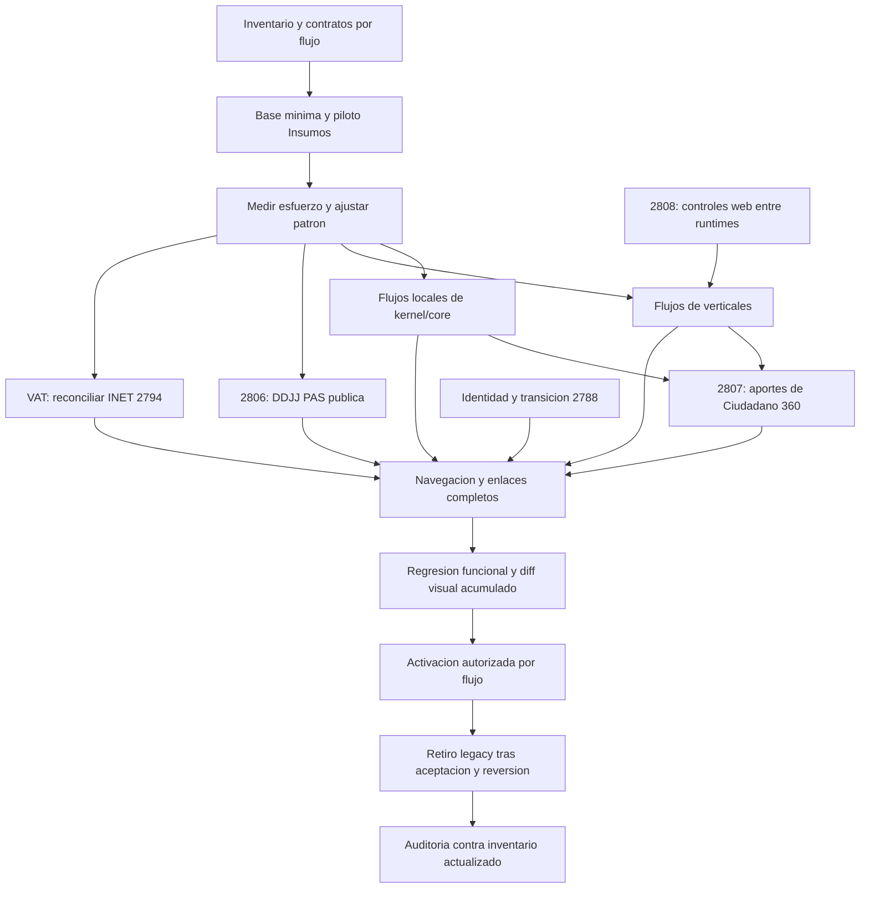

# Secuencia integral por flujos (#2785)

Fecha: 2026-10-27. Propuesta operativa sobre el plan aprobado. Fuente de
asignación actual: `ae0b0da01c546d801f18237c3c6dab29a5496790`.

Alcance vigente **E2**: profundizar planificación integral, sin implementación.
[Delta de integraciones](2026-10-27-2786-delta-integraciones.md) a
`59a8f797688c9e762d5a4e9eaa187698ffade8aa`. El
[catálogo de entregas](2026-10-27-2785-entregas-por-flujo.md) descompone las 95
familias en 214 slices propuestos con perfiles de contrato/negativos. No son
214 tickets ejecutables ni una estimación de esfuerzo.

## Regla vigente M2

Todos los formularios del alcance terminan en React. Los tramos siguientes
ordenan desarrollo y validación, no autorizan activar una lectura con formularios
Django pendientes en su circuito. Agrupar lectura/ABM/acciones y retornos que
dependan entre sí; conservar feedback, permisos y diseño. El piloto aislado es
evidencia parcial. La UI Django de otros circuitos es temporal y bloquea el
cierre integral. Admin/Unfold #2789 queda fuera, excepción confirmada por el responsable.

## Preparación que desbloquea cada entrega

| Preparación | Qué debe estar resuelto | Qué permite avanzar |
|---|---|---|
| B0: fuente e impacto | Snapshot/delta, rutas concretas y consumidores indirectos, baseline a aceptar cuando exista entorno autorizado | Evita planificar sobre un PR antiguo o perder URLs fuera del menú |
| B1: contrato y acceso | Datos/acciones/estados de service actual, sesión/invitación, permiso/objeto y consumidor; API existente apta o brecha acotada | Derivar una unidad de código sin inventar negocio ni autorización |
| B2: paridad y herramientas | Manifiesto visual, fixtures declaradas, app incluida en checks/schema; alcance de regresión según diff | Evita una pantalla sin pruebas o comparación incompleta |
| B3: frontera G1 | Protocolo cerrado antes de nuevas APIs web remotas; procedencia y requisitos sin callback circular | Desbloquea esas APIs de verticales, sin exigirlo al piloto local ni modificar APIs PWA por asociación |

B0/B1/B2 se repiten por entrega, no son un gran bloqueo que obligue a especificar
214 contratos antes de empezar cualquier código futuro. B3 solo bloquea la
frontera que necesita. Un catálogo o endpoint existente no prueba que B1 esté
cerrado. La relación es de planificación, no un grafo de llamadas demostrado.

## Orden recomendado y trabajo independiente

| Tramo | Alcance | Dependencia fuerte | Qué puede seguir legacy |
|---|---|---|---|
| P0: definiciones | Inventario/delta, contratos, baseline y riesgos; E2 actual | Evidencia fuente, decisiones materiales y alcance del responsable | Toda aplicación operativa |
| P1: patrón | Contexto/menú, shell fiel, herramientas y lectura/descarga Insumos | B0–B2 del piloto; no requiere implementar login React o G1 remoto primero | Login, alta/edición/baja y categorías Django |
| P2: transversal/identidad | Inicio/encuesta, cuenta/login/reset, utilidades, usuarios/grupos, auditoría y tableros | Contrato de cada recorrido; completar entradas públicas y prioridad de estados | Flujos aún no migrados y backend de autenticación |
| P3: bases de dominio | Ciudadanos, organizaciones/proyectos, espacios, centros, dispositivos, escuelas y catálogos | Contratos de dueño/objeto; B3 si incorpora API remota nueva | Acciones legacy enlazadas desde ficha cuando compatibles |
| P4: operaciones | Nóminas, asistencia, actividades, beneficiarios, trabajadores, intervención/observación | Estado/permiso/transacción de cada acción; no solo ficha padre | Circuitos de documentos y reportes aún no migrados |
| P5: circuitos/jobs | Admisión/seguimiento, rendiciones, expedientes, informes, OCR/importaciones/cruces/mailing y PAS | Contrato completo de estados, efectos, archivos, jobs y reintentos; P1 público PAS respetado | Generación PDF/correo, motores, workers y conectores backend |
| P6: composición | Ciudadano 360 JSON por dueño, navegación/aliases y recorridos de extremo a extremo | Aportes/contratos listos, C2 y B3 donde corresponde; sin HTML remoto final | UI independiente excluida, no los bloques insertos en 360 |
| P7: integración/retiro | Diff acumulado, regresión, activación autorizada y retiro posterior por flujo | Evidencia y aceptación completa de cada flujo afectado | Django de dominio/autorización/documentos y excepciones aprobadas |

INET es una línea de contraste transversal: ya integrado, revisar V02–V07 y
mantener solo remanente; no esperar a P5 para descubrir que algo ya existe.
PAS público puede prepararse antes de otros circuitos si P1/CSRF/entrada están
cerrados. Los tramos son orden técnico propuesto, no sprints ni prioridades de
negocio confirmadas. No exigen terminar todo P3 antes de una operación independiente.

La precedencia funcional depende de la unidad: la ficha del padre facilita
navegación; los retornos a formularios Django deben resolverse antes de activar su circuito M2. Compatibilidad de URLs no equivale a conservar UI Django final.
No bloquear una entrega por toda una familia si solo necesita un contrato de
consulta disponible. No paralelizar cambios sobre el mismo archivo común sin
coordinar dueño; los cambios de infraestructura no se infieren de estas líneas.

La [matriz de flujos](2026-10-27-2786-matriz-flujos.md) da un ID a 95 familias,
con fuente/URLs, candidatos de API/services/tests, resultado a preservar y riesgo.
Las 770 declaraciones literales quedan asignadas: 614 a familias y 156 a
apoyo/exclusiones explícitas. Son declaraciones, no pantallas ni un porcentaje
de migración terminado. El orden siguiente es técnico propuesto; no reemplaza
prioridades funcionales del responsable ni promete un calendario sin medir capacidad.

## Camino de trabajo

No exige terminar un vertical completo para empezar otro. Cada flujo pasa por
la misma cadena: fuente actual y contrato → API mínima/reutilización → componentes
React → pruebas positivas/negativas → diff visual de todas las URLs afectadas →
aceptación → activación separada → retiro posterior. Las dependencias de contrato
y archivos compartidos determinan qué puede avanzar sin conflictos.

## Frentes y unidades de entrega

| Frente | Familias de la matriz | Cómo se toma y dependencia material |
|---|---|---|
| Base y piloto | I01, #2798–#2802 | Contexto web, manifiesto, shell idéntico, checks/contrato y consulta/descarga Insumos. El contexto de sesión se implementa después de cerrar #2798; no requiere migrar primero el login |
| Transversal/kernel | T01–T07, I02–I03, A01 | Novedades/programas/utilidades, archivos/categorías, inicio/encuesta, arquitectura y papelera. Separar lectura, mutación y restauración; no importar negocio remoto al kernel |
| Identidad/administración web | U01–U08, E01–E04 | Login/cuenta/reset y requisitos forzados; gestión de usuarios/grupos, jobs y encuestas. U08 es compatibilidad de consumidores, no reconstrucción PWA/SIIS. Usuarios/grupos/credenciales requieren revisión de seguridad propia |
| Ciudadanos | C01–C05 | Listado/ficha/ABM, familia, revisión, jobs importación y aportes. Contrato de importación incorpora #2764; aportes necesitan #2807 antes de reemplazar HTML remoto |
| Comedores base | CO01–CO08, DU01 | Ficha/listados, nómina/asistencia, colaboradores/actividades, observaciones/intervenciones y catálogos/prestaciones. Dividir cada acción; conservar reglas históricas actuales, sin ejecutar pendientes #142/#1103 por implicación |
| Organizaciones | O01–O05 | Contrato integrado #2775: programas/proyectos, convenios, firmantes/avales, documentos y rendiciones por línea. Baseline de versión aceptada, no del formulario anterior |
| Circuito Comedores | AD01–AD03, AC01, R01–R03, EX01–EX02, RM01, RF01, CM01–CM03 | Separar transiciones técnicas/legales, documentación y jobs. UI de gestor de templates sí entra; motor/PDF/correos quedan backend. No convertir estado visible en update de campo ni enviar mensajes reales en pruebas |
| CDI | CDI01–CDI09 | Centros, nóminas/formularios, asistencia, trabajadores, intervenciones/adjuntos, observaciones, reportes y usuarios de integración. Conservar permisos locales/SSE y el comportamiento de redirects legacy |
| CDF | CDF01–CDF04 | Empezar por contrato de consulta centros #2805; después actividades/espera/asistencia, beneficiarios/responsables y CABAL por flujos. API key no llega al navegador ni se quita del consumidor de integración |
| Dispositivos/DataCalle | DS01–DS02, DC01–DC02 | Catálogo/legajo y mapa con #2792 coordinado; operativos/casos, equipo y cierre. No migrar app de campo, sincronización offline ni semántica de reintentos por asociación |
| Inspecciones | IN01–IN05 | Escuelas, asignaciones, importaciones en tres pasos, actas/archivos/tablero. Importación materializa diez rutas; resultado POST es UI. Mantener layout claro de ese módulo y permisos de gestión |
| PAS | PAS01–PAS06 | Padrón/estados, cruces/importaciones, informes/áreas y DDJJ. #2806 separa formulario público por invitación de descargas administrativas y padrón protegido |
| OCR | OCR01–OCR02 | Upload múltiple, estado/resultados y descarga del job autorizado. Mantener worker/motor/almacenamiento y rechazo de documento ajeno |
| VAT/INET | V01–V08 | Comparar V02–V07 con rutas/acciones reales de #2794 antes de abrir otra implementación; migrar solo remanente. Vouchers/parametrías/evaluaciones no se consideran cubiertos automáticamente |
| Dashboards | D01 y métricas de familias dueñas | Conservar permisos, embeds y contratos remotos. Vacío/caída/cero deben interpretarse según contrato; no prometer medición real por recibir cero de un fallback |

## Hitos observables

| Hito | Evidencia de salida |
|---|---|
| Patrón del piloto | Consulta/filtro/página/descarga de Insumos con datos sintéticos, API y permisos, misma UI, diff por URL/estado/rol/viewport; rechazo 403/archivos/expiración comprobado |
| Entrada a un dominio | Dueño/rutas, contrato compatible, alcance y datos definidos, pipeline incluye app/API, mecanismos de requisitos web resueltos para su runtime |
| Flujo entregado | Todas sus acciones y documentos cubiertos, no solo lista; PR/head SHA y checks, aceptación positiva/negativa, estados de entorno separados |
| Navegación integrada | Inicio, cuenta, login/reset, menús, enlaces legacy, next/query/hash, reload, errores y accesos públicos/privados con recorridos verificados |
| Preparación de activación | Diff visual acumulado sobre versión integrada y conjunto completo de URLs tocadas, regresión de consumidores compartidos, control de permisos directo, plan de rollback probado |
| Retiro seguro | Sin rutas activas pendientes ni consumidores de templates/assets que se eliminen; documento/correo/admin identificado, versión previa compatible y aceptación/observación por entorno |
| Cierre de épica | Inventario actualizado reconciliado contra implementación real y excepciones aprobadas; usuario acepta flujos. CI/deploy/health/aceptación acreditados por separado |

La igualdad visual exigida es con la UI actual de cada flujo. No se uniforman
todos los módulos al shell MUI existente, no se agregan temas/controles porque
otra app los tenga y no se adopta como referencia un PR todavía sin aceptación.

## Cómo convertir una familia en issue pequeño

La ficha debe identificar su ID de matriz, rutas exactas y acciones, dueño,
roles/alcance, resultado positivo y negativo, contrato/services, archivos/import/
export, dependencias, casos visuales, tests/checks, riesgos y reversión. Debe
nombrar qué falta definir; un listado de modelos no basta. No se crean 95 tickets
de implementación por la mera existencia de 95 filas.

Cuando haya variantes, dividir por recorrido comprobable: listado+detalle de
lectura, alta, edición/baja, una transición con sus adjuntos, un job de importación
o un reporte/descarga. Mantener en una misma entrega los cambios de contrato y
su consumidor compatibles; separar activación/retiro de la primera migración.

## Capacidad, coordinación y pendiente real

Después del piloto registrar tiempo real de definir API, implementar, probar,
comparar visualmente, corregir y obtener aceptación. No multiplicar un promedio
por HTML ni estimar complejos de transacciones a partir de una lista de lectura.
La cantidad de flujos que puede migrarse en la ventana original depende de esa
medida y de contratos/aceptaciones; no se baja el criterio de calidad para cumplir
una fecha. Ninguna medida de capacidad se obtuvo aún.

Antes de tocar código: reconsultar development y PRs. #2789/#2793 mantiene su
propiedad de admin, configuración y recursos relacionados; #2794 la de INET y
cambios compartidos. Publicar paths/dueño de cada cambio común en la tarea antes
de ejecutarlo, resolver la base y no sobrescribir trabajo ajeno. La planificación
solo escribe documentos nuevos; no mueve/rebasea ramas ni altera esos PRs.

La asignación literal ya es completa a nivel de esta extracción. Para cerrar
#2786 todavía falta reconciliar exposición activa por runtime, contratos,
permisos/objeto/provincia y templates dinámicos de cada flujo. #2787 necesita
contrastar esas brechas y sus consumidores; #2788 necesita resolver decisiones
de entry/gates/rutas y su comprensión material. Los cuatro tickets de definición
#2805–#2808 abordan fronteras concretas; no representan APIs corregidas.

## Precisión posterior de activación

Los tramos anteriores ordenan desarrollo. INS-A agrupa I01/I03 y INS-B agrupa
I02 para activar con formularios React y feedback propios; no publicar solo
lectura como migración completa. Ver [contrato](2026-10-27-2785-insumos-circuitos-m2.md).
INET edición de centros sigue [R1 elegida](2026-10-27-2794-permisos-edicion-centro.md)
para conservar autorización Django; revisión técnica/pruebas posteriores. El piloto local no depende de implementar ese ajuste.
