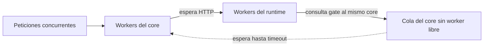

# Alternativas de control web entre servicios (#2808)

Fecha: 2026-10-27. Estado: **G1 elegida por el responsable; protocolo pendiente**.
Continúa el [plan aprobado](2026-10-27-2785-migracion-integral-react.md) y el
[contrato local de contexto](2026-10-27-2798-contrato-contexto-web.md). No es un
protocolo aceptado ni una implementación de autenticación/middleware/infraestructura.
La elección explícita «g1» queda en el
[registro de decisión](../../registro/decisiones/2026-10-27-2808-control-web-g1.md).
La [especificación G1 para revisión](2026-10-27-2808-protocolo-g1.md) concreta
datos, transporte, errores, compatibilidad y validaciones todavía pendientes.

## Problema y resultado observable

Las APIs web nuevas deben conservar acceso web, cambio de contraseña, perfil y
encuesta obligatoria, además del permiso y alcance del dominio. No alcanza con
mostrar el bloqueo en React o consultar contexto una sola vez al abrir la app.
Una petición posterior y el acceso directo al runtime tienen que quedar
definidos, sin alterar contratos PWA/API key/token ni invitaciones públicas PAS.

## Hechos encontrados en el repositorio

| Fuente | Hecho y límite |
|---|---|
| `src/backends/kernel/core/backend_proxy.py` | El core recibe tráfico y usa `requests.request` síncrono hacia el runtime, reenviando cookie/headers originales. Espera respuesta; `stream=True` no lo convierte en proxy asíncrono |
| `docker/django/entrypoint.py` | El lanzamiento del core usa por defecto cuatro workers y un thread. Son defaults de código, no configuración de producción verificada |
| `docker/compose/docker-compose.deploy.yml` | CDF y otros runtimes usan Gunicorn y no publican puertos en esta definición. No demuestra por sí solo que todo entorno real conserve esa exposición ni que otros procesos internos no puedan alcanzarlos |
| `src/backends/config/backend_settings.py` | Los runtimes quitan middleware/context processor de encuestas porque el dueño es el core; no pueden importar esa app para resolver la API localmente |
| `src/backends/kernel/users/middleware.py` y `src/backends/sisoc_core/encuestas/middleware.py` | `/api/` está exento; preservar estos archivos no activa automáticamente controles de las nuevas APIs |
| `src/backends/kernel/core/internal_services.py` | Hay handlers locales y HTTP con sesión, sin reintentar mutaciones ni aceptar URL del cliente. El registro depende del backend dueño; no hay aquí un servicio de política independiente ni una prueba de origen del request |
| `src/backends/kernel/core/backend_proxy.py`, `outbound_headers` | Se recalculan Host/forwarded headers; el resto se reenvía según filtros existentes. No hay una constancia de evaluación del gate que el runtime pueda verificar como tal |

La sesión y la SECRET_KEY están compartidas según el contrato del proxy actual.
Ninguna opción de este documento convierte esa topología en aislamiento de
datos o protección frente a un runtime comprometido; eso pertenece a otra decisión.

## Por qué no recomendar callback al mismo pool del core

Si el runtime pregunta al mismo proceso/pool del core que ya espera su respuesta,
se introduce un ciclo. Con concurrencia suficiente todos los workers disponibles
del core pueden estar esperando respuestas de runtimes, mientras esos runtimes
esperan que el core atienda la comprobación de acceso.

Es un riesgo causal del diseño nuevo inferido del código, **no un incidente ni
una prueba de carga ejecutada**. Los timeouts acotan la espera pero no hacen
útil la respuesta. Aumentar workers/threads desplaza el umbral; no elimina el
ciclo. Por eso una consulta HTTP de política requiere otro pool/proceso sin
callbacks a los servicios que la esperan, o un mecanismo sin esa llamada.

## Alternativas y recomendación

| Opción | Mecanismo | Ganancias | Costos / pérdidas |
|---|---|---|---|
| G1. Gate en core y constancia interna firmada por petición | Core evalúa requisitos antes de reenviar; runtime autentica sesión, comprueba constancia acotada al request y autoriza dominio/objeto. Sin callback | Conserva proxy y cantidad de servicios, evita ciclo y RPC adicional por request; usa herramientas del framework existente | Nuevo contrato interno de firma, canonicalización, expiración, manejo de headers y observabilidad. Requiere pruebas de spoof/replay/rotación/monolito, y revisión técnica |
| G2. Consulta de política a proceso/pool separado | Runtime autentica y pregunta a un proceso core de política independiente, solo con reglas locales y sin llamadas circulares | Autoridad central consultada por request, sin transportar una constancia reutilizable de autorización | Nuevo proceso/servicio, routing/origin configurado, health/deploy y consumo de recursos; RPC/timeout adicional y dependencia de disponibilidad. Hay que medir capacidad, no asumirla |
| G3. Solo gate público + red privada | Core comprueba antes del proxy y runtime conserva permisos de dominio; se confía en que el público no llegue al runtime | Menor diff y sin protocolo/RPC nuevo | Una petición interna/directa con sesión puede saltar encuesta del core. La privacidad de puertos no verifica por sí misma el origen. No satisface el negativo fuerte de acceso directo definido en #2808 |

**Recomendación del agente: G1**, si el responsable acepta un contrato interno
nuevo y la confianza compartida actual. G2 queda como alternativa si se prefiere
pagar operación/RPC para evitar esa constancia. G3 se descarta para el criterio
de rechazo directo al runtime. El responsable eligió G1 explícitamente después
de revisar estas alternativas. Esta elección no aprueba automáticamente el
namespace, parámetros del protocolo ni cambios de autenticación/infraestructura.

## Alcance propuesto de G1 para poder revisar la decisión

### Separar APIs web nuevas de consumidores existentes

Se recomienda un espacio explícito `/api/web/<dominio>/...` para las nuevas
operaciones web; `/api/web/session/` sigue siendo introspección del propio estado
y no exige que el usuario esté ready para explicarle una remediación. Las
entradas públicas de login/reset o PAS por invitación necesitan rutas/exenciones
exactas con sus propios controles, no una exención global de ese prefijo.

Esta propuesta evita un segundo listado informal de qué APIs viejas «parecen
web». No modifica `/api/users/`, `/api/vat/web/` existente, PWA, integraciones,
admin, media o router de assets `/v2/`. Exige revisar antes de implementar las
URIs propuestas de Insumos (`/api/insumos/`) y CDF; todavía no hay contratos
runtime que romper. Si se elige conservar otro esquema de URI, se debe definir
registro/descubrimiento de los endpoints protegidos y su prueba de omisiones.

### Responsabilidades

1. **Core, política de usuario:** la misma composición de requisitos que el
   contexto #2798, sin copiar segmentación de encuestas ni consultar un vertical.
   Ejecuta antes del proxy y antes de servicios de negocio locales en monolito.
2. **Core, transporte:** elimina/sobrescribe cualquier header de constancia
   recibido del cliente; solo emite constancia cuando la política permite el
   request. Nunca la entrega a React ni al servidor estático.
3. **Runtime, sesión y procedencia de evaluación:** autentica la cookie actual
   y verifica la constancia para la misma sesión/identidad/ruta/método. Sin
   constancia válida no ejecuta una API web protegida, aunque la sesión sea válida.
4. **Runtime, dominio:** conserva permiso, objeto, provincia/centro/equipo,
   validación, CSRF y transacción. La firma no autoriza editar un objeto ni
   reemplaza volver a comprobar esas reglas en el servidor.
5. **Composición local:** el gate corre también antes de endpoints locales
   de `settings_all`; no se exige un viaje HTTP a sí mismo. Runtimes no importan
   usuarios/encuestas del core ni incorporan sus middleware por accidente.

Es probable que la implementación necesite una capa de control en el core y
verificación compartida del kernel, configuradas solo para los nuevos endpoints.
Los nombres/ubicación exactos y el registro deben definirse con el contrato;
no se crea otro registry o middleware genérico sin justificar por qué los puntos
de integración actuales no alcanzan. Config/settings/backend_settings son zonas
de revisión técnica y se coordinan con #2789/#2793.

### Contrato mínimo de la constancia: todavía por cerrar

- Versión y propósito separados de autenticación, método y path/query
  canonicalizados, referencia ligada a sesión/usuario y tiempo de emisión.
- Datos mínimos; sin cookie/CSRF/token de PWA, lista de permisos, DNI ni perfil.
  Una firma no cifra el contenido. No registrar ni devolver el valor real de
  la constancia en logs, Sentry, errores o artefactos.
- Firma/verificación con primitivas existentes del framework; sin criptografía
  propia ni dependencia nueva. Salt/clave/rotación y su límite de confianza
  compartida deben quedar escritos antes de implementar. Una clave compartida
  no distingue a un core legítimo de otro proceso confiable que también la tiene.
- Expiración y tolerancia de reloj definidas tras revisar cola/uploads; verificar
  llegada antes de parseos largos para no invalidar un upload por su duración.
  No elegir un TTL arbitrario en esta propuesta ni cachear política por sesión.
- La expiración **no prueba uso único**. Un mensaje interceptado podría repetirse
  dentro de su ventana y binding; no prometer anti-replay absoluto sin otra
  decisión. Si se requiere impedirlo, evaluar G2 o el mecanismo adicional con
  su costo/estado; no agregar cache/nonce persistente silenciosamente.
- No se firma una autorización de negocio ni se reintenta una mutación si falla
  la red. El core evalúa el momento de la petición; no promete que una regla
  externa nunca cambie mientras la operación ya está en curso.

Este inventario de campos no es un formato de header/schema aceptado. La
propuesta hace visible el costo de G1 para no venderla como «solo un header».

## Pruebas y condiciones de salida propuestas

| Caso | Propiedad que debe demostrarse |
|---|---|
| Petición nueva normal en core→runtime y monolito | Misma sesión/requisitos y autorización de dominio, sin callback circular |
| Sin cookie, token sin cookie, sesión expirada | No hay datos privados ni constancia que habilite negocio; consumidor PWA conserva contrato separado |
| Header aportado por cliente | Core lo elimina/sobrescribe; runtime no confía en campos sueltos ni headers forwarded como prueba |
| Request directo al runtime con cookie válida, sin constancia | Rechazo previo a query/mutación de negocio |
| Firma alterada, sesión/usuario/ruta/método/query diferentes, encoding ambiguo | Rechazo y logging mínimo sin secreto; definición de canonicalización cubre parámetros repetidos y rutas codificadas |
| Vencimiento/clock skew, queues y upload prolongado | Política de frescura comprobada al punto definido, sin exigir cargar cuerpo completo para verificar el gate |
| Perfil/permiso cambia después del gate | Runtime vuelve a validar lo que le corresponde; límites de consistencia explícitos |
| Repetición dentro/fuera de ventana | Documentar exactamente qué se rechaza y qué no se garantiza; no confundir CSRF/firma con idempotencia de negocio |
| Rotación, versión anterior y rollback | No falla toda la UI al mezclar versiones; compatibilidad y retiro de nueva API coordinados antes de quitar el gate |
| PWA/API key/token, PAS invitado y admin | Sin controles web nuevos por coincidencia de ruta; regresiones de consumidores y #2789 |
| Concurrencia | En entorno aislado autorizado, demostrar ausencia de callback y comportamiento ante saturación. Un test con HTTP mockeado no prueba capacidad |

No se ejecutó ninguna prueba de carga, firma, DB ni servidor. Se inspeccionó
código y configuración fuente; los valores de entorno/despliegue reales no
fueron leídos. La validación de #2808 actual es una propuesta revisable.

## Elección y trabajo restante antes de ejecutar

El responsable eligió G1 mediante «g1». No se vuelve a pedir esa elección.
La justificación técnica y las condiciones para reconsiderarla son propuestas
del agente; la respuesta no demuestra comprensión ni aceptación individual de
cada parámetro pendiente. El registro acepta la alternativa, sin declarar
aprobado un protocolo todavía inexistente.

El siguiente entregable de #2808 debe cerrar, en este orden:

1. Integración: ubicar la evaluación del core y la verificación del runtime antes
   del acceso a datos; cubrir también ejecución local sin llamada HTTP a sí misma.
2. URI y remediación: resolver el namespace propuesto y las excepciones exactas
   de contexto/login/reset/PAS; conservar los contratos de consumidores actuales.
3. Protocolo: especificar formato/versionado, audiencia del runtime, identidad y
   sesión, método, ruta/query realmente reenviados y rechazos por ambigüedad.
   La representación firmada debe ser la que el runtime recibe: no asumir que
   normalizar una URL dos veces preserve encoding, orden o parámetros repetidos.
4. Ciclo de vida: definir primitiva del framework, propósito, clave/rotación,
   expiración y tolerancia a reloj tras revisar tiempos de cola/uploads. Proponer
   valores con evidencia; no convertir defaults del proxy en presupuesto probado.
5. Errores y compatibilidad: especificar status/códigos sin redirigir APIs a HTML,
   ausencia/alteración/vencimiento, logs sin constancia y despliegue gradual sin
   aceptar temporalmente requests de negocio sin verificación. El rollback debe
   retirar/desactivar la nueva ruta, nunca abrir un bypass del gate.
6. Evidencia: convertir la tabla de negativos en pruebas del contrato acordado,
   comprobar no filtración hacia navegador y coordinar settings con #2789.

La revisión del contrato y el control de comprensión de Cognitive ownership
siguen pendientes antes de ejecución arquitectónica. El piloto local de Insumos no necesita resolver esta
frontera como si ya hubiera migrado todos los runtimes, pero tampoco la elimina
del plan integral.
